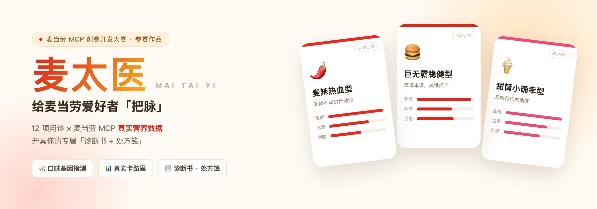
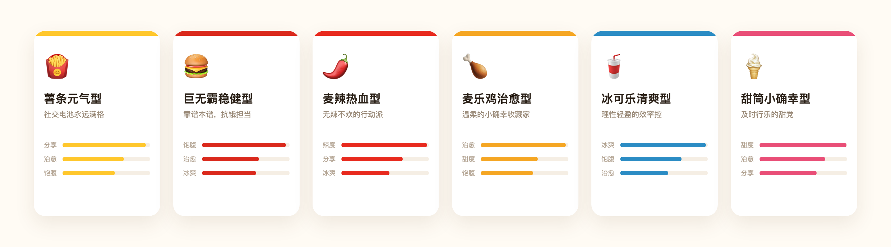
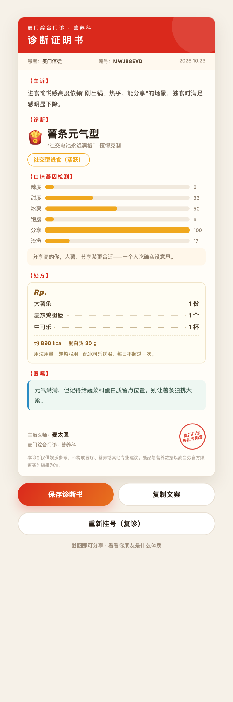
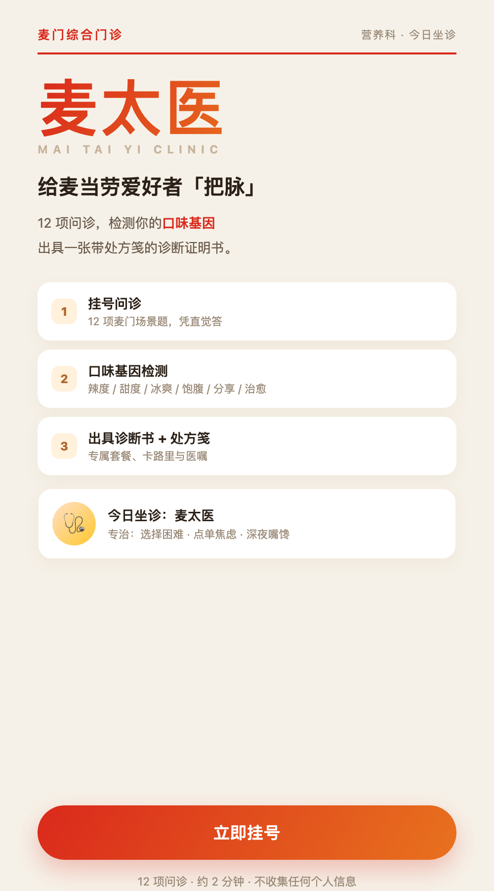

<h1 align="center">麦太医 · 麦门体质诊断</h1>

<p align="center">
  <b>麦门综合门诊开业：12 项问诊，检测你的口味基因。</b><br/>
  不是又一个"你是哪种汉堡"的心理测试 —— 是一张有主诉、有处方、有医嘱、可截图分享的<strong>诊断证明书</strong>。
</p>

<p align="center">
  
  
  
  
</p>

---

## 👀 先看效果

**六种诊断，总有一款是你：**



**问诊结束后，你会拿到这样一张诊断证明书：**

<p align="center">
  
</p>

> 主诉 · 诊断 · 六维口味基因 · Rp. 处方笺 · 医嘱 · 医师签名与门诊印章 —— 手机截图就能发朋友圈。

---

## 🤔 这是什么

你有没有过这种时刻：

- 朋友群里聊"你是 I 人还是 E 人"，你想说：**我更想知道我是哪种薯条人。**
- 减肥期点了个"看起来很健康"的套餐，结果一查热量 900 大卡，当场沉默。
- 站在点餐机前，看着 30 多个 SKU，突然不知道自己要什么。

**麦太医就是为这些时刻准备的。**

它把「看医生」这个人人熟悉的流程搬了过来：**挂号 → 问诊 → 把脉 → 诊断 → 开处方 → 医嘱**。12 项问诊判断你的口味基因，再用麦当劳 MCP 的真实餐品与营养数据，给你开一张带处方笺的诊断书。

### 为什么是「就医流程」？

因为麦门信徒对麦当劳的感情，本来就有点像"看病"：

- 心情不好 = 需要一味「麦乐鸡」；
- 深夜嘴馋 = 急性发作，得立刻处理；
- 减肥期路过门店 = 需要意志力会诊。

用门诊的形式讲这件事，既贴切，又好笑，还自带仪式感 —— **这是全榜 100 多个项目里没人做过的形态。**

### 为什么叫「麦太医」？

「太医」是古代给皇帝看病的医生，望闻问切、对症下药。**「麦太医」给麦当劳爱好者「把脉」——但把的不是病理，是你的口味基因。**

它不搞算命、不测运势，落点是**健康、有趣、能分享**。

---

## 🎯 目标用户

| 人群 | 他们的痛点 | 麦太医怎么解决 |
|---|---|---|
| **麦门信徒 / 麦当劳常客** | 想用有趣的方式表达对麦当劳的热爱，缺一张能晒的"凭证" | 一张带诊断、处方、门诊印章的诊断书，发朋友圈自带话题 |
| **选择困难的点餐人** | 站在点餐机前，面对 30 多个 SKU 不知道点啥 | 12 项问诊直接给出「处方」，不用再纠结 |
| **控卡 / 健身人群** | 想吃又怕热量超标 | 处方标注真实卡路里与蛋白质，心里有数 |
| **WorkBuddy / MCP 开发者** | 想找「趣味场景 × 真实 MCP 数据」的落地范例 | 完整可复用的 Skill + 零依赖前端实现，可直接参考改造 |

---

## 🆚 为什么不是又一个「麦门 MBTI」

榜单上已经有好几个麦门人格测试。麦太医的差别只有一条，但很关键：

| 对比维度 | 常见的「麦门 MBTI」 | **麦太医** |
|---|---|---|
| 测什么 | 心理性格标签 | **六维口味基因（辣/甜/冰/饱/分享/治愈）** |
| 数据来源 | 事先写死的文案 | **麦当劳 MCP 实时餐品 + 营养数据** |
| 结果形态 | 一段文字或一张人格卡 | **诊断证明书 + Rp. 处方笺 + 门诊印章** |
| 体验设计 | 答题 → 出标签 | **挂号 → 问诊 → 初步诊断 → 精修 → 诊断书** |
| 是否有热量 | 无 | **有，真实卡路里 + 蛋白质** |
| 是否可行动 | 测完就完了 | **直接告诉你开什么"药"，还能查券** |
| 合规导向 | 娱乐向 | **健康正向，不做占卜迷信** |

一句话：**别人测「你是谁」，麦太医测「你该怎么吃」。**

### 六维雷达到底有什么用？

很多测试给你六个抽象形容词（元气、稳健、热血…），看完不知道能干嘛。麦太医的六维是**能直接指导点餐的口味基因**：

| 维度 | 测出来高，意味着 | 直接影响 |
|---|---|---|
| 辣度 | 你对辛辣刺激的需求强 | 该点麦辣系列，别点不辣的 |
| 甜度 | 你依赖甜味收尾 | 甜筒/麦旋风是你的本命 |
| 冰爽 | 冰饮是你的底线 | 饮料要加冰，但注意护胃 |
| 饱腹 | 不吃主食会心慌 | 巨无霸、双层吉士才压得住 |
| 分享 | 一个人吃没意思 | 大薯、分享装更合适 |
| 治愈 | 你靠熟悉的味道缓解情绪 | 麦乐鸡，但别情绪化进食 |

**每一项分数都对应一句可执行的建议**，这才是雷达存在的意义。

---

## 🧬 六种麦门体质详解

| 体质 | 诊断名（玩梗） | Rp. 处方 | 参考热量 | 医嘱 |
|---|---|---|---:|---|
| 🍟 **薯条元气型** | 社交型进食（活跃） | 大薯条 1 份 / 麦辣鸡腿堡 1 个 / 中可乐 1 杯 | ~890 kcal | 元气满满，但记得给蔬菜和蛋白质留点位置，别让薯条独挑大梁 |
| 🍔 **巨无霸稳健型** | 饱腹感焦虑（轻度） | 巨无霸 1 个 / 中薯条 1 份 / 中可乐 1 杯 | ~940 kcal | 稳健是优点，偶尔也允许自己不均衡一点 |
| 🌶️ **麦辣热血型** | 辣度依赖（中度） | 麦辣鸡腿堡 1 个 / 中薯条 1 份 / 中可乐 1 杯 | ~790 kcal | 辣爽可以，但别让胃替你买单；配冰饮记得少冰 |
| 🍗 **麦乐鸡治愈型** | 情绪性进食（轻度） | 麦乐鸡（6 块）1 盒 / 中薯条 1 份 / 甜酸酱 2 包 | ~720 kcal | 治愈自己很重要，但要警惕情绪化进食，规律三餐 |
| 🥤 **冰可乐清爽型** | 冰饮依赖（中度） | 双层吉士汉堡 1 个 / 零度可乐 1 杯 / 玉米杯 1 份 | ~520 kcal | 自带控卡天赋，但蛋白质别落下，轻盈不等于饿着 |
| 🍦 **甜筒小确幸型** | 糖分渴望（轻度） | 圆筒冰淇淋 1 支 / 香芋派 1 个 / 小薯条 1 份 | ~460 kcal | 甜是奖赏，不是日常；用一支甜筒换走烦恼可以，别换来超标 |

> 表中热量为示例参考值；实际以麦当劳 MCP 实时返回为准。
> 诊断名是玩梗，**不构成任何医疗判断**，诊断书底部常驻此声明。

---

## 💬 使用示例：一次真实的对话

```
你：麦太医，给我把把脉

麦太医：欢迎光临「麦门综合门诊 · 营养科」，先给您挂个号。
        12 项问诊，凭直觉答就行 👇

  【第 1 项 / 共 12 项】
  薯条刚出锅，还冒着热气，你的第一口？
  A. 先蘸辣酱，够味
  B. 先蘸冰淇淋，甜咸双杀
  C. 配一大口冰可乐
  D. 抓一大把塞满嘴，先垫肚子

你：D

  【第 2 项 / 共 12 项】你一个人来麦当劳，最常因为？
  A. 约了朋友，先来占座
  B. 心情不好，需要安静待会儿
  C. 就是馋那口辣
  D. 想奖励自己一个甜的

你：以上都不是，我就是加班顺路

麦太医：收到，已按「饱腹」计入 ✅

...（答满 8 项，先出一份初步诊断）

麦太医：初步诊断已生成 —— 🍔 巨无霸稳健型
        口味基因目前偏向「饱腹」与「分享」。
        再答 4 项可以更准，也可以直接开发。

你：继续

...（答完剩余 4 项）

麦太医：诊断完毕 —— 🌶️ 麦辣热血型
        诊断：辣度依赖（中度）· 骨子里带火

        Rp. 麦辣鸡腿堡 1 个 / 中薯条 1 份 / 中可乐 1 杯
        约 790 kcal · 蛋白质 32g

        医嘱：辣爽可以，但别让胃替你买单。

        [诊断证明书已出具]
```

---

## 🚀 快速开始（安装方法）

### 第一步：拿到麦当劳 MCP Token

1. 打开[麦当劳 MCP 使用指南](https://github.com/M-China/mcd-mcp-server)。
2. 右上角【登录】→ 手机号验证。
3. 点击【控制台】→【激活】→ 申请 Token → 复制。

### 第二步：在 WorkBuddy 里配置 `mcd-mcp`

在 WorkBuddy 左侧【专家·技能·连接器】→【连接器】→【自定义连接器】→【配置 MCP】，填入：

```json
{
  "mcpServers": {
    "mcd-mcp": {
      "type": "streamablehttp",
      "url": "https://mcp.mcd.cn",
      "headers": {
        "Authorization": "Bearer 你的_TOKEN_填这里"
      }
    }
  }
}
```

> 脱敏版见 [`mcp-config.example.json`](mcp-config.example.json)（使用 `${MCD_MCP_TOKEN}` 占位，切勿提交真实 Token）。

### 第三步：装上麦太医

```bash
# 用户级安装（所有项目可用）
mkdir -p ~/.workbuddy/skills
git clone <本仓库地址> ~/.workbuddy/skills/maitaiyi
```

### 第四步：把脉

在 WorkBuddy 对话框里说：

> **麦太医，给我把把脉**

或者：

> **测测我是哪种麦门体质**

---

## ⚡ 免安装直接玩（推荐）

### 方式 A · 网页版，0 安装

直接打开 [`index.html`](index.html)（双击即可，手机上也能开）：

12 项问诊 → 出诊断书 → **一键保存图片 / 复制分享文案**。

<p align="center">
  
  
</p>

> 想直接看结果页？打开 `index.html?demo=spicy`（可换成 fries / bigmac / nuggets / cola / cone）。

### 方式 B · 脚本版，零依赖

只要有 Python 3.8+：

```bash
python3 scripts/report_card.py --type spicy
```

会在 `outputs/` 下生成 `maitaiyi-report-spicy.html`，浏览器打开即可看到完整诊断书。

想看别的体质：

```bash
python3 scripts/report_card.py --type fries    # 薯条元气型
python3 scripts/report_card.py --type bigmac   # 巨无霸稳健型
python3 scripts/report_card.py --type nuggets  # 麦乐鸡治愈型
python3 scripts/report_card.py --type cola     # 冰可乐清爽型
python3 scripts/report_card.py --type cone     # 甜筒小确幸型
```

接入 MCP 实时数据时，把套餐与营养传进去：

```bash
python3 scripts/report_card.py \
  --type bigmac \
  --meal "巨无霸超值套餐（含中薯 + 中可乐）" \
  --cal 940 --protein 38
```

---

## 🏗 技术架构

```
┌──────────────────────────────────────────────────┐
│ WorkBuddy 对话框                                  │
│   "麦太医，给我把把脉"                             │
└──────────────────────┬───────────────────────────┘
                       ▼
        ┌──────────────────────────────┐
        │ SKILL.md 定义的工作流          │
        │ ① 12 项问诊  ② 六维计分     │
        └──────────────┬───────────────┘
                       ▼
        ┌──────────────────────────────┐
        │ 麦当劳 MCP（真实数据）         │
        │  query-meals        餐品检索   │
        │  list-nutrition-foods 营养卡路里│
        │  query-my-coupons   优惠券彩蛋  │
        └──────────────┬───────────────┘
                       ▼
        ┌──────────────────────────────┐
        │ report_card.py（零依赖）       │
        │  组装 HTML 诊断书              │
        └──────────────┬───────────────┘
                       ▼
              📄 可分享的诊断证明书
```

**设计上的小心思：**

- **六维口味基因**——不是只给你一个标签，而是画出辣度 / 甜度 / 冰爽 / 饱腹 / 分享 / 治愈六个维度的真实得分，主打维度自动加粗，并给出对应的点餐建议。
- **报告编号 + 日期**——像真的体检报告一样有仪式感，截图发出去更像"我的报告"而非"一张图"。
- **配色随体质变化**——每张卡的主色取自该体质的代表色，六张图放在一起也不会撞色。
- **内置免责声明**——"非医疗建议"常驻卡片底部，既合规也显专业。

---

## 🧭 项目结构

```
maitaiyi/
├── index.html              # 纯前端网页版（12 项问诊 → 诊断书，零安装）
├── README.md               # 项目介绍（本文件）
├── CONTEST_DECLARATION.md  # 参赛声明（官方原文件，未做任何改动）
├── MCP_INTEGRATION.md      # MCP 集成说明（Server / Tool / 流程 / 业务价值）
├── mcp-config.example.json # 脱敏的 MCP 配置示例（环境变量占位）
├── workbuddy.md            # WorkBuddy 对话上下文（专项奖励核验用）
├── HOW_TO_SUBMIT.md        # 手把手提交指南（建仓库 → 传文件 → 发 Issue）
├── SKILL.md                # Skill 主体：出题 → 计分 → 判定 → 调 MCP → 出报告
├── scripts/
│   └── report_card.py      # 诊断书生成器（纯标准库，可独立运行）
├── assets/                 # 视觉素材（banner、六体质图、卡片示例）
└── outputs/                # 生成的诊断书输出目录
```

---

## 🧩 MCP 集成

实际使用的 Tool：`query-meals`、`list-nutrition-foods`、`query-my-coupons`。

完整调用流程、体质→关键词映射、业务价值说明见 👉 **[MCP_INTEGRATION.md](MCP_INTEGRATION.md)**

---

## ❓ FAQ

**Q：这算医疗或营养建议吗？**
不算。所有输出仅供娱乐和参考，卡片底部常驻"非医疗建议"声明，具体饮食请咨询专业人士。

**Q：一定要连麦当劳 MCP 吗？**
连上体验最好（真实餐品 + 真实营养）。不连也能跑，脚本内置示例数据，适合快速预览。

**Q：我的订单/账号数据会被上传吗？**
不会。麦太医只读取你主动触发的查询结果，项目本身不收集、不存储任何个人信息。

**Q：能改成别的题吗？**
可以。题目、计分映射、六种体质的文案都在 `SKILL.md` 和 `scripts/report_card.py` 里，改完即用。

---

## 🏆 参赛信息

本项目参加 **麦当劳程序员节创意开发大赛**，基于麦当劳 MCP 能力开发，使用腾讯 WorkBuddy 完成。

- 参赛声明：[CONTEST_DECLARATION.md](CONTEST_DECLARATION.md)
- MCP 集成：[MCP_INTEGRATION.md](MCP_INTEGRATION.md)
- WorkBuddy 开发上下文：[workbuddy.md](workbuddy.md)

---

## ⚠️ 免责声明

本项目为「麦当劳程序员节创意开发大赛」参赛作品，由参赛者独立开发，**非麦当劳官方产品**。报告输出仅供参考，不构成医疗、营养或其他专业建议；餐品信息、价格及供应状态以麦当劳官方渠道的实时结果为准。

## 📄 License

MIT License © 2026 参赛者

---

<p align="center">
  <b>测完记得回来说一声，你是哪种体质 👋</b>
</p>
